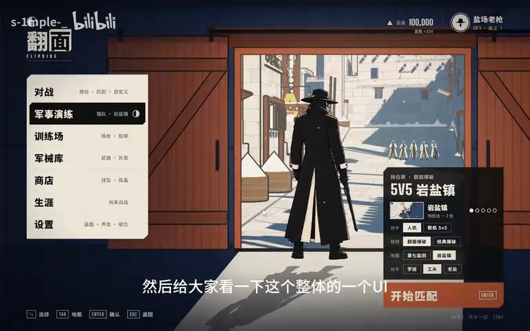
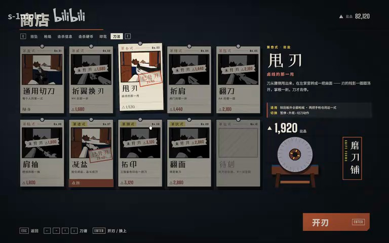
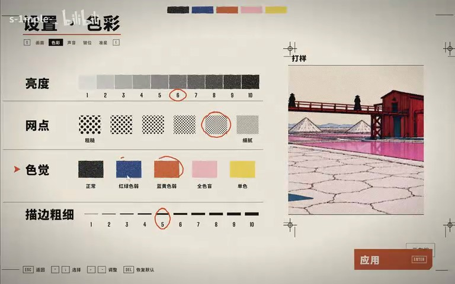
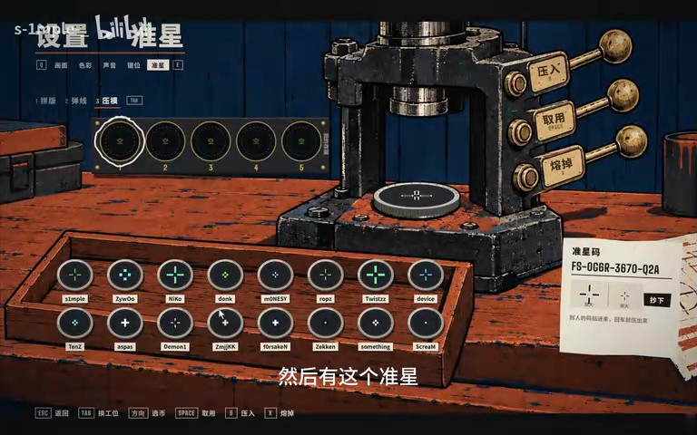
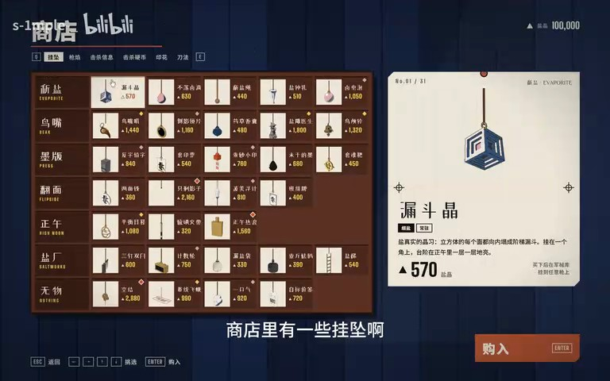

# 《翻面 FLIPSIDE》视觉复核与复用指南

**最有依据的归纳：漫画式三维空间，叠加印刷工坊的材料、字体与交互语言。**

「翻面·印刷工坊美学」是为这份 skill 起的组合名称。它强调纸、墨、校样、档案、机械器物与清楚的信息组织。具体作品可以保留其中的关系，而不搬用游戏角色、武器或菜单。

原视频：[耗时四天，我用 opus5.5 做了一款射击游戏并上架了](https://www.bilibili.com/video/BV13MxT63EqD/)，作者 s-1mple-_。初次复核于 2026-10-29，skill 完成于 2026-10-30。

本次使用公开的 480p / 30 fps 视频，按解码时间检查全片概览、前段密集画面和 14 组连续动作。详细方法及全部原图见[证据索引](references/evidence.md)。以下将画面观察、视觉归纳与迁移建议分别说明。

## 2026-11-08 深化复核与 v2

用户持续使用后的反馈表明，v1 容易产生配色相近、动作简单的作品。入口首先要求选择纸面、颜色、字体和现成布局，概念创造只占一条原则。Quiet 模式进一步把风格缩减到配色和字体。已有样张证明了基础可读性与交互行为，审美验收的覆盖不足。

这次重新检查准星页、光学窗、键位抽屉、主页和沙盘，以及相关连续画面，把设计判断落实到以下关系。

### 功能怎样成为一个令人愿意观察的对象

准星压印台的吸引力来自多个层面相互支持。圆形样本提供可选内容，中央圆盘和压头建立作用位置，三组把手对应操作，纸签显示可带走的结果。用户能从熟悉的结构中理解陌生的组合，进一步观察时仍能找到用途与细节。

这个解释可以迁移到新领域。图片比较围绕同一坐标的对位，规划工具围绕依赖与阻塞，科学图解围绕真实作用点。功能、内容和操作频率决定概念的抽象程度，具体布局也随之改变。完整推导见[概念规范](references/design-reasoning.md)。

### 棱角、圆滑与线条怎样共同塑造形体

源作把不同形状放在合适的位置。压印机的承重框架方正厚实，转轴和承盘具有圆形截面，手柄端部圆滑，纸签轻薄且局部弯曲。主页的门框与建筑提供直线骨架，人物衣摆、帽檐和姿态提供曲线节奏。

因此需要分别判断轮廓曲率、平面转折、厚度与阴影边缘。一个圆滑物件仍可采用清楚的明暗分面。线条也各有职责，强轮廓与遮挡建立边界，较轻的构造线解释连接，细线组织信息，疏密变化的纹理表达材料。具体方法见[形体与光线规范](references/form-light-space.md)。

### 光线怎样把画面组织起来

主页门外的大亮面、室内较暗的包围、人物深色剪影和地面长影一起建立焦点与纵深。机械台的亮边、深接缝与接触阴影则交代分量和材质。光线同时服务体积和观看顺序。

迁移时先明确主要光向、受光面和落点，再处理表面颜色。金属的集中高光、纸的宽阔漫反射、木面的纹理方向应分别设计。场景的蓝影随结构分布，阅读面保持平静。全局明暗和局部细节需要共同检查。

### 动作怎样让概念变得可信

键帽从字模区进入动作配对位置，转印图案从输入画布移动至目标对象，沙盘镜头由全局进入选中位置。这些动作帮助用户追踪对象身份与结果。

v2 要求为核心动作确定输入、可动部分、约束、作用位置和落定状态。影子、遮挡和材料响应随动作协调变化。静态作品用对位、路径、截面和前后状态表达同一关系。现有准星片段可确认装置结构与呈现，完整压头执行过程仍未核实。

### 这次如何检查 skill

新版使用两个不同题材进行独立试用，分别面向章节编排交互和原理汇报静态图解。评估依据新增的[审美验收规范](references/evaluation.md)，重点核对完成画面的概念、形体、线条、光影与信息关系。实际样张和发现记录在[验证记录](VALIDATION.md)。

## 1. 整体美术：平面印刷与立体空间同时成立

主菜单中，人物处于门框与远处城镇之间，透视、遮挡和投影都清楚；左侧纸菜单与右侧配置面板则服务于快速阅读。

场景使用深色轮廓、简化的材质、成块的明暗。暖纸色受光面与蓝色阴影形成空间，长投影引导视线。近处的木桌、机械和纸卡细节较多，远景与天空更简洁，复杂度集中在当前对象上。

**澄清：** 可以确认漫画式非写实观感。视频无法证明具体使用了哪种 shader，也无法据此判定所有阴影、线条和纹理分别由什么技术生成。

**复用：** 设计静态页面时可以用取景窗、遮挡、裁切和硬影表达空间；做动态页面时再使用三维或视差。学术图像保留原貌，把风格放到外框、标签与说明上。

## 2. 字体：至少四种角色，而非一套“复古字体”

| 角色 | 视频里能确认的特征 | 推荐的复用方式 |
|---|---|---|
| 页面标题与导航 | 粗重紧凑的黑体，如「商店」「军械库」 | 主标题与操作名称承担直接的信息层级 |
| 商品名、物件名 | 宋/明朝体气质，粗细笔画对比清楚，如「甩刀」 | 用在章节、案例、作品或重要概念的题名 |
| 柜号、价格、短英文 | 窄长、大字面、强调垂直节奏 | 用在章节号、关键数字和短标签 |
| 正文、操作提示 | 小而规整，与标题形成明显尺度差 | 按目标媒介的阅读距离增大，不照搬视频小字 |

**澄清：** 具体字体家族仍无法可靠识别。思源黑体、思源宋体、Barlow Condensed 等在 skill 中都被列为替代建议。原作的小标签也不能一概认定为等宽字体。

在 PPT 中，最有效的搭配是黑体承载信息、宋体提供少量编辑气质，必要时加窄体数字。保持正文、公式、坐标轴为清楚且可编辑的文字。

## 3. 页面与组件质感：不同表面有不同做法

设置页直接把亮度、网点和描边做成印刷样条，配上红色手画圈、细线与套准标记。右侧「打样」让设置结果有明确落点。

纸不是统一的发黄滤镜：有校样纸、档案、票据、吊挂照片和纸签等不同形态。部分卡片有切角、夹子、图钉、短硬影。油墨在插画和装饰里出现颗粒、网点与磨损；主要文字仍需清晰。

压印台进一步加入黑金属、黄铜与暖木桌。材料有厚度和使用痕迹，但阅读信息落在清楚的纸签与样本上。

**复用：** 让纹理服从材料：纸面轻颗粒，墨色有局部缺口，木框有方向纹理，金属只在器械上有高光。每页不必全部出现。文字、图表与表格优先保持干净。

## 4. 色彩：冷暖与明暗分工，比一张色卡更关键

常见关系是：纸白承载阅读，墨黑建立文字和轮廓，深蓝承载外壳/阴影，锈橙提示操作与状态，粉黄为辅助色。不同页面的面积分配变化很大：既有浅色校样，也有深蓝工坊和暗房。

| 色彩角色 | 复用建议色值 |
|---|---|
| 纸白 | `#ECE5D6` |
| 墨黑 | `#20211F` |
| 深蓝 | `#182C45` |
| 冷蓝 | `#30466C` |
| 锈橙 | `#A64F32` |
| 灰粉 | `#D5A3AD` |
| 芥黄 | `#D9C45B` |

这是一组整理后的设计建议。视频像素取样会受纹理、光照、压缩影响，例如纸面区域中位色约 `#E0DBCF`—`#EDE5D7`，锈橙按钮所取区域为 `#91432C`。原图矩形与结果保存在[取色记录](references/palette-samples.json)。

**本次明确纠正：** 设置里的「红绿色弱、蓝黄色弱、全色盲、单色」是色觉模拟，不能据此把那些选项解释成主题配色。色盘判断主要依据多个实际页面反复出现的颜色关系。

## 5. UI 安排与排版：骨架稳定，场景变化

页面经常保留相近的操作骨架：左上身份与分类、右上状态、中央主体、底部次级控制、右下主动作。商品页用左侧集合和右侧详情，编辑页用左输入/中央对象/右工具，沙盘页用全局地图与对应档案。

这种稳定关系支持了很大的美术变化。它并没有把每一页都套成三张卡片。

组件的状态也有层次：选中项抬起或增亮，未激活项降低注意力；「已购」「已入册」「在用」「未开刃」分别表达对象状态；主按钮保留清楚的动作与快捷键提示。方正、切角、细边框与反白块构成主要界面语言，圆形主要用于仪器、轮盘、标志和准星。

**复用：** 保持身份、选择、详情和主行动的关系；移动端可以重排，PPT 可以用标题、页码和结论承担对应角色。真实产品中的搜索、表单和数据表仍可使用熟悉的结构。

## 6. 动效：前一版的“滑入与盖章”概括过窄

通过连续画面能确认以下过程：

| 视频时间 | 实际过程 | 迁移用途 |
|---|---|---|
| 00:21.5–00:22.3 | 视线推进，两个圆形窗口由小到大揭示场景，器械外壳随后建立 | 比较视图、观察窗口 |
| 00:31.6–00:32.8 | 滚轴从右向左展开纸面，物件分批出现 | 展开一张新信息面 |
| 00:45.2–00:47.2 | 纸页绕纵轴翻转，切到另一种工作台 | 同一对象的另一面、同层级切页 |
| 01:50.6–01:52.0 | 柜门围绕铰链打开，进入内部陈列 | 从集合进入细节 |
| 02:29.6–02:31.0 | 图案随纸片离开左侧画布，移动至对象，留下印制结果 | 输入到输出、应用变更 |
| 07:27–07:31.4 | 半黑半白圆形翻转放大，接为黑白阵营，再圆形揭示实机 | 两面、对照、两种状态 |
| 08:28.9–08:30.3 | 场景收成卡片，翻出字标背面，再由斜向不规则边缘揭开 | 章节或品牌转场 |
| 08:48.8–08:50.8 | 路线与标记出现，镜头推入选中标牌 | 从全局进入局部 |

查看[动作联系表与规范](references/motion.md)可以核对过程。原视频的精确曲线与作者设置的时长未知；skill 的毫秒数是单独标记的复用建议。

这套动作的重点是起点、去向和物件连续性。局部选择可以短促，章节可以完整展开；常用控件不应重复播放大片头。静态交付保留完整落定状态，减少动态时仍保留同样的信息。

## 7. 这次额外找到的设计亮点

**每种功能都有自己的物件解释。** 画面设置用光学比较窗，声音设置用中心角色与声源，键位用字模抽屉，准星用压印台，地图选择用沙盘。这比“每页加纸纹”更能形成完整设计。

**主题进入了转场结构。** 「翻面」同时体现在半黑半白圆、阵营对照、卡片正反面和品牌字标中。可复用的是这一条贯穿形状、叙事和动作的原则。

**样本就是演示。** 商店的纸卡内部播放相关效果，选项与结果在同一张卡上，用户不用仅靠名字猜测。

**物件带着状态和经历。** 已购章、在用标签和价格纸签让卡片像档案的一部分；主按钮的「显影」「入册」「印」也延续了工艺语言。迁移到业务和科研时，动作名仍需让人明确知道会发生什么。

**装饰有密度差。** 复杂机械和精细插画旁边有大面积纸白或深色空场，远景不和主对象争细节。

**定量信息需要另行判断。** 零击杀画面中的罐子已经装满硬币，所以硬币堆不是可直接复制的准确图表编码。研究结果应使用真实刻度、数值和图例。

## 8. 如何用于你之后的工作

| 任务 | 优先保留 | 适度减弱 |
|---|---|---|
| 学术 PPT | 纸墨配色、字体角色、校样式对照、清楚的图表 | 装饰颗粒、极小标签、频繁三维转场 |
| 静态网页/报告 | 编辑式秩序、图注、编号、窗口与纸面关系 | 无内容含义的机械道具 |
| 产品 UI | 稳定导航、选择/详情关联、状态区分、短反馈 | 阻碍操作的场景动画 |
| 动态网页 | 场景与面板分层、局部展开、物件连续性 | 所有元素同时漂浮 |
| 演示视频 | 关键帧、动作语义、冷暖空间、章节转场 | 没有阅读停顿的连续特效 |

这份 skill 将上述内容写成可执行的审美规则，并附源画面与联系表。入口是 [SKILL.md](SKILL.md)，调用名为 **`$flipside-design`**。
