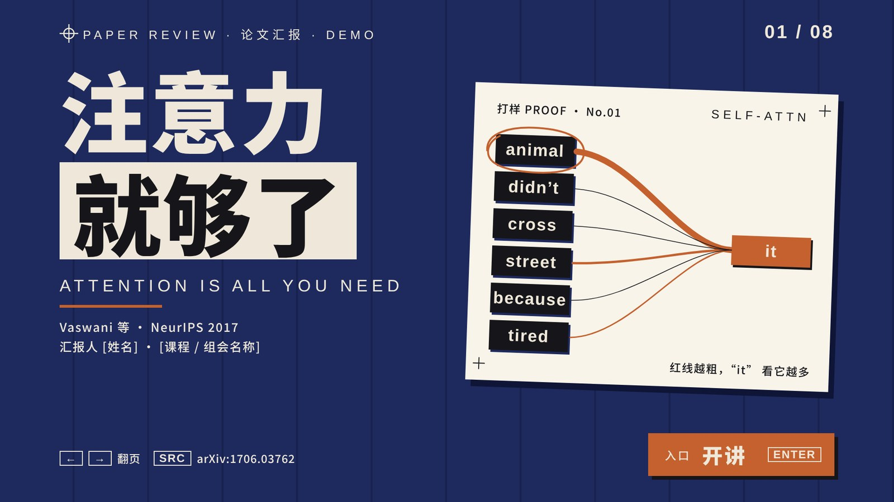
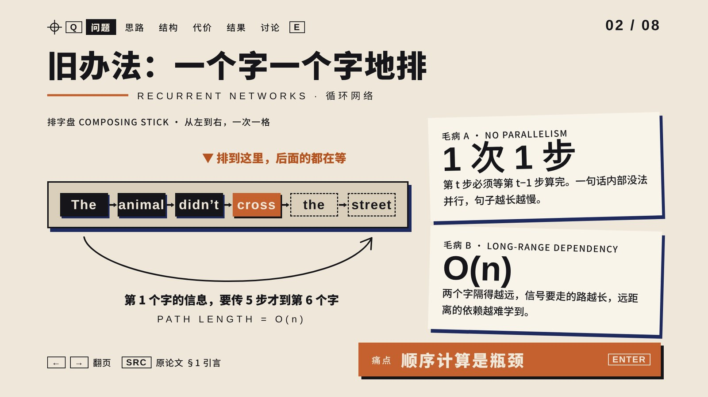
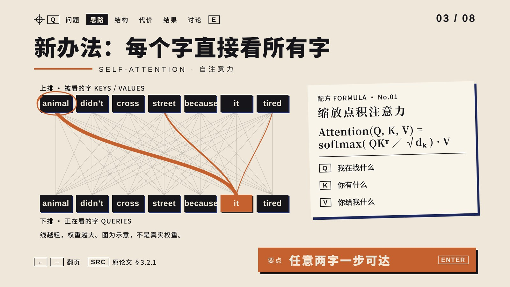
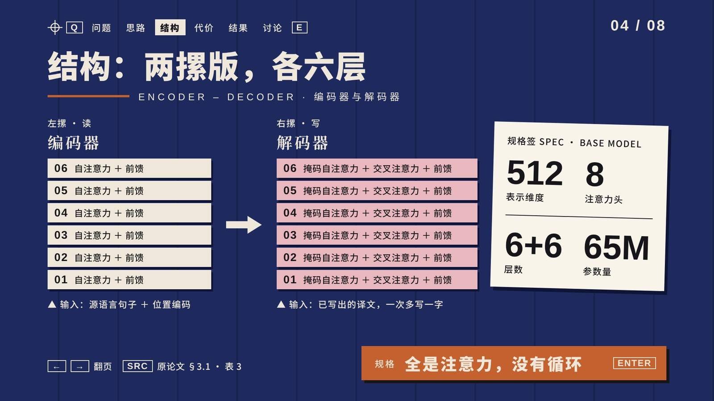
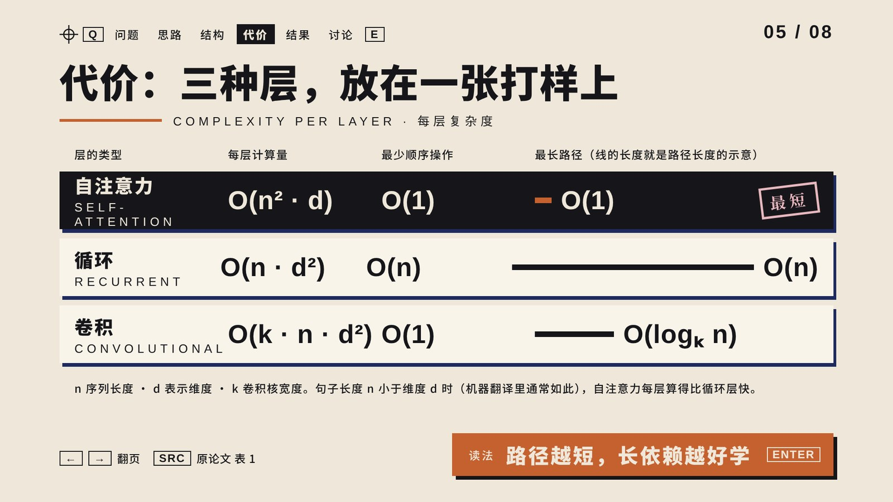
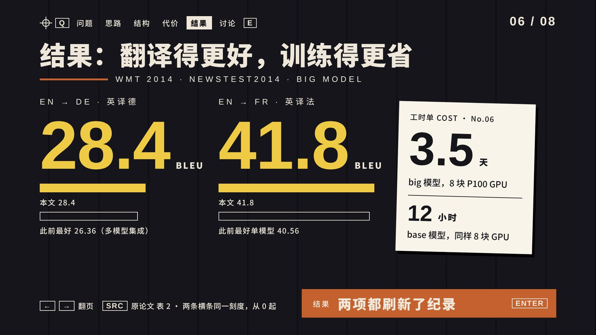
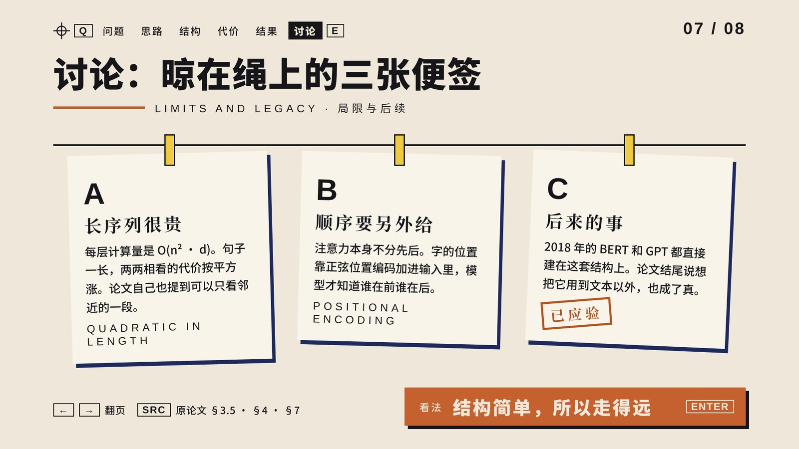

# 墨坊 Inkworks · 审美 skill

把界面和页面当作工作台上的印刷物与实物来设计。一份 `SKILL.md`，用于 PPT、网页、UI、动效、海报。

> 使用 inkworks-aesthetic 作为审美标准，帮我做一份学术论文汇报 PPT。

审美来源于 [《耗时四天，我用 opus5.5 做了一款射击游戏并上架了》](https://www.bilibili.com/video/BV13MxT63EqD/) 里那款游戏的 UI。这里不复刻它的画面，只取它的做法。

## 样张

用这份 skill 做的一套 8 页学术汇报（内容取自 *Attention Is All You Need*）：

| | |
|---|---|
|  |  |
|  |  |
|  |  |
|  |  |

截图在没有网络字体的环境里渲染，拉丁字母用的是回退字体；正式字体是 Noto Sans SC 900、Noto Serif SC、Barlow Condensed。源文件在 [`examples/academic-deck/`](examples/academic-deck/)。

## 它讲什么

1. **功能即物件**：每个功能先问它在实体世界里是哪件东西、靠哪个动作完成。
2. **控件即样本**：让量自己说话，线的粗细就是权重，线的长度就是路径长度。
3. **边框守规矩，舞台才能放肆**：四角信息位永远不动，中间每页都可以是不同的场景。

落到手上是[八个签名动作](SKILL.md#15-八个签名动作任何浓度任何媒介都要全部出现)：四角边框、标题三件套、行动块、硬投影与微倾斜、一处手的线、一枚章、双语编号小字、一个样本式表达。

## 和旧版的区别

旧版（v1、v2，仓库历史里还在）有 8 份参考文档和 40 多张原视频截图，讲的是形体、光线、构图的一般原理。原理没有错，但做出来的东西是“米色底、中号标题、一个深色框”，认不出是这套审美。

这一版反过来：

- 只留一份 `SKILL.md`，写的是做法和数值，不是原理。
- 八个签名动作必须全部出现，少一样就会滑回稳妥稿。
- 默认浓度从“克制”改成“标准”，学术汇报也一样。
- 母题从内容里找（语言模型用排字房，通信用报务台），印刷坊只是回落。
- 删掉了原视频截图。那些画面属于原作者，skill 也不需要靠它们工作。

## 安装

**Claude**：把 `SKILL.md` 的内容保存为名为 `inkworks-aesthetic` 的 skill。

**Codex**：

```text
~/.codex/skills/inkworks-aesthetic/SKILL.md
```

把整个仓库放进这个目录即可。旧的 `$flipside-design` 调用名不再使用。

## 文件

- [`SKILL.md`](SKILL.md)：全部规则。
- [`assets/inkworks.css`](assets/inkworks.css)：五墨变量和常用物件（纸片、铅字块、章、行动块、边框）的起步样式。
- [`examples/academic-deck/`](examples/academic-deck/)：样张的截图、样式和每页源文件。

## 来源

视觉规则是对公开视频画面的归纳与再设计；色值、字号、时长是本仓库自己定的。原视频、游戏及其素材的权利归原作者。
