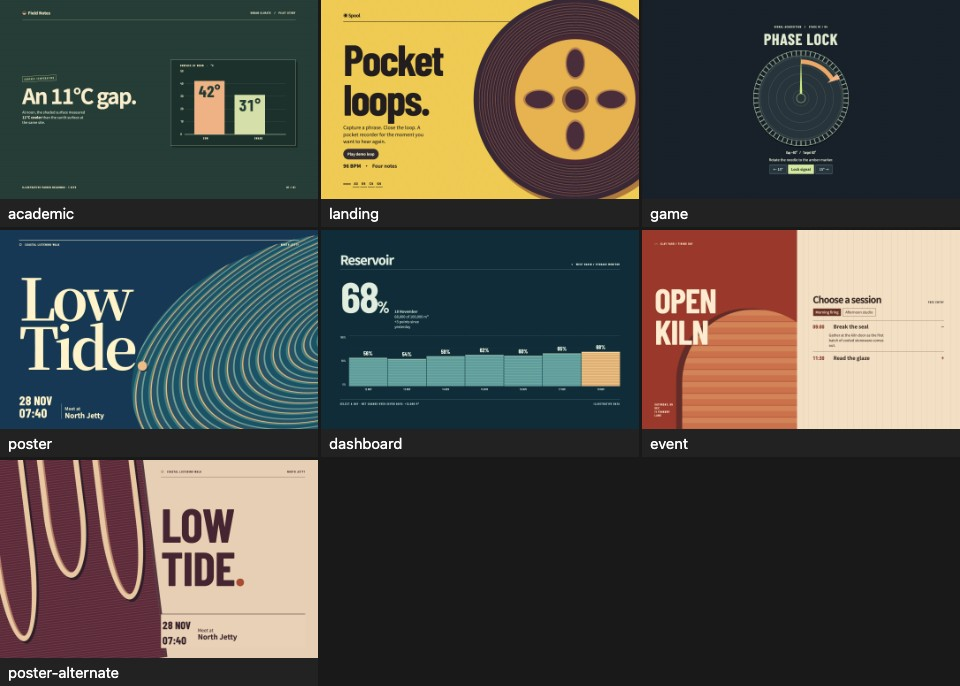
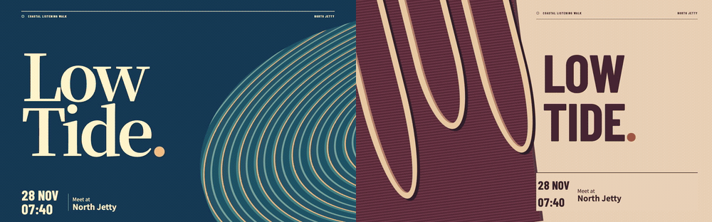

# 墨坊 Inkworks

给网页、幻灯片、UI、动效和海报用的审美 skill。仓库名为 `inkworks-design-skill`，调用名为 `$inkworks-aesthetic`。

> 使用 $inkworks-aesthetic 做一页学术汇报。让观众先看到日照和阴影的温差，再能核对两处温度。



## 如何使用

把整个仓库安装到可发现的 skill 目录。以 Codex 为例，首次安装运行：

```sh
git clone https://github.com/yuchenlogin/inkworks-design-skill.git ~/.codex/skills/inkworks-aesthetic
```

从 [SKILL.md](SKILL.md) 开始。先为项目写一页 [world.md](reference/world.md)，定下内容为何需要这种材料、主角做什么动作、最后留下什么信息。实现时按需取[中性 CSS](assets/inkworks.css) 和[八个可离线打开的动效配方](recipes/README.md)。取舍有冲突时回到[作者的两次选择](taste/principles.md)。

## 看同一内容怎样产生两个世界

同一场 Low Tide 海岸聆听步行，两张海报保留活动名、时间和集合点。打开[第一张海报](examples/poster/index.html)和[另一种世界设定](examples/poster-alternate/index.html)，比较轮廓、材质和入场运动。下载后直接用浏览器打开 HTML 即可体验。



其余小样分别是[温差学术汇报](examples/academic/index.html)、[可试听的循环录音机](examples/landing/index.html)、[相位锁定游戏](examples/game/index.html)、[水库看板](examples/dashboard/index.html)和[可切换场次的开放日](examples/event/index.html)。旧版 Transformer 幻灯片的[四处设计判断](reference/instances.md)保留作对照。

## 如何知道一次修改是否有效

用[六条固定题目](evals/suite.json)出稿，用[渲染工具](tools/render)生成目标尺寸截图、联系表和帧序列。把相邻页缩小、遮字，检查主角和结构；再对照[评分表](reference/scoring.md)逐页修订。查看[本版评测记录](evals/results.md)与[版本变更](CHANGELOG.md)。 三页[车门开闭小样](previews/series.jpg)单独检查同一项目内的构图变化。
