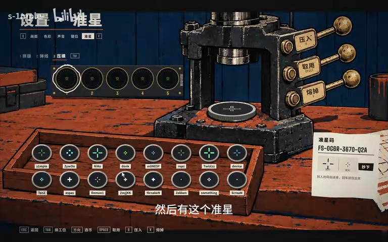
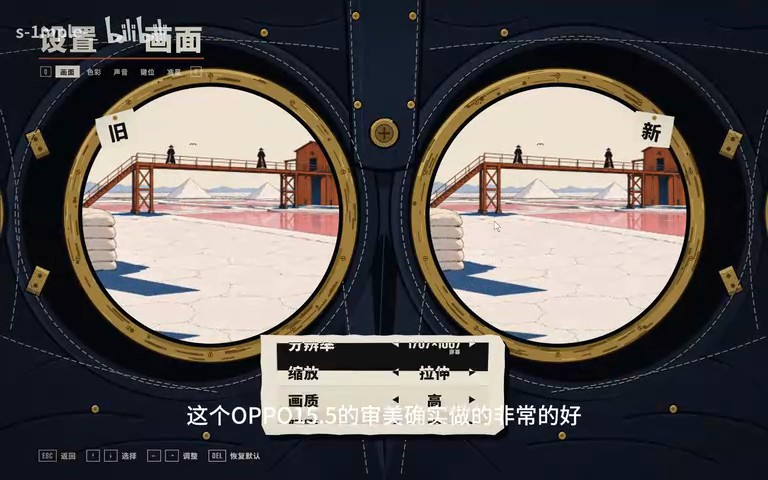
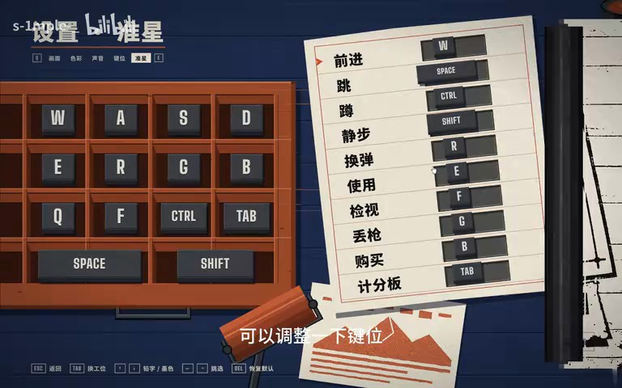
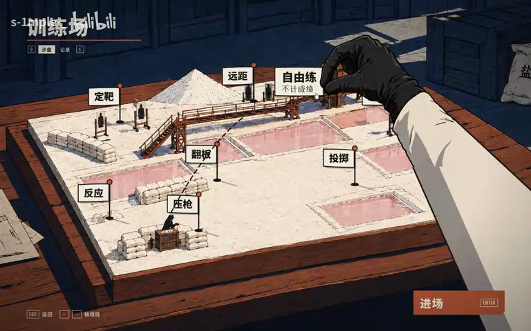

# 从功能构思到具有个性的设计

本文件给出基于源画面的设计解释与迁移方法。它表达对作品的分析，作者本人的创作意图仍未取得。

## 为什么准星压印机能成立

画面把几种原本分散的关系组织在同一处。

| 可见细节 | 可以读出的关系 | 迁移时的设计问题 |
|---|---|---|
| 托盘内的圆形准星样本 | 选项成为可辨认、可拿取的单位，排列便于扫描 | 被选择的内容能否保持自己的形状与身份 |
| 中央圆盘与上方压头 | 形成一个明确的承接位置和作用方向 | 操作究竟作用在哪里，结果将出现在哪里 |
| 方正桥架、圆柱、球形把手 | 支撑、运动、接触分别具有合适形状 | 每一种形体能否解释自身用途 |
| 「压入」「取用」「熔掉」把手 | 操作词、位置和器械结构相互支持 | 控件是否紧邻它影响的对象，动作是否可预测 |
| 右侧带预览与代码的纸签 | 配置获得可识别、可带走的结果 | 最终结果能否被看见、核对和再次使用 |
| 大框架、中等圆盘、小样本与细纸签 | 尺度差产生秩序、分量感与节奏 | 主体是否有清楚的大小层级和阅读顺序 |

压印机带来的新鲜感可以解释为一种恰当的意外。用户认识准星配置的目的，也能认识压印机的作用，二者之间出现了清楚的对应。继续观察时，零件、标签、材料和布局维持了这种对应，概念因此有了完成度。

这一帧可确认装置结构与控件。现有片段没有完整展示一次压头执行、回位的连续操作，相关机械时序应作为新设计建议处理。

## 同一审美世界如何容纳不同概念

双圆窗把新旧画面的共同视点和比较关系放大。圆形在这里来自观察孔，两个相似形状帮助对照。外壳和调节纸签支持观察，关键内容留在窗内。

键位页利用字模与键帽的形似和可搬运性。左边提供单位，右边建立动作与按键的配对。表格因此有了与功能相关的构造。

沙盘让训练项目具有空间位置，标牌指向可进入的内容。手、台面、模型和远处库房分别建立前后层次。用户借助模型理解整体，再进入局部。

这些页面共享线条、明暗、材料和信息层级。它们的核心形状由各自任务产生。迁移到新主题时，也应允许主视觉和布局发生显著变化。

## 从当前任务推导概念

先描述操作或论点，尽量使用具体动词。用户在对齐两张图、排列一段叙事、追踪一次变化、比较几种方案，或理解一个结构。随后寻找能把这些关系显示出来的组织方式。

概念可以停留在不同抽象程度。

| 表达程度 | 适用情况 | 设计方式 |
|---|---|---|
| 内容原生结构 | 研究、复杂数据、专业工具 | 从剖面、坐标、时间轴、层级、样本或差值建立构图，让材料、线条与光线完善它 |
| 空间或物理对应 | 操作有明确承接、方向或对应关系 | 用对位、叠合、嵌入、揭开、聚合、展开等关系帮助理解输入和结果 |
| 完整物件或场景 | 创意入口、关键编辑行为、展览与演示 | 围绕实际任务设计装置或场景，建立可读的结构、控制位置、状态和结果 |

选择取决于任务的认知负担、使用频率和表达目标。专业界面可以在关键区域具有很高的艺术完成度，文字与表格依然保持高效。

方向开放时，在草图层面比较几个不同概念。判断它们能否改善理解、容纳真实内容、产生有特点的构图，并在重复使用中保持方便。把选中的方向写成一句可执行的话，例如“让用户沿同一条剖切位置核对模型内部和外部的对应”。这句话应能导出位置、形体和动作。

## 把概念落实为完成的对象

一个有潜力的隐喻需要结构设计。

1. 确认内容单位和结果的身份，列出实际需要的状态。
2. 安排承载、连接、约束与操作位置。运动件应有可理解的轴、轨道、接触面或展开边界。
3. 确定主轮廓和大中小形体关系，给关键部件足够的辨识空间。
4. 为形体选择材质和受光方式，区分厚实结构、灵活部件、信息表面。
5. 把标题、数值和标签放到它们解释的对象附近，保留清楚的读取方向。
6. 用完成画面验证概念。若画面依赖长篇解释才能成立，继续改构图或对应关系。

这些是可往返的设计问题。简单任务可以在一张草图中同时解决，复杂场景则需要多次调整。

## 泛化的示范推理

以下方案用于展示推导过程，可据新任务继续创造。

### 图片细节比较

用户需要核对同一位置的细节。共同坐标和固定比例是核心关系。可以设计两张叠合的样片与一条可移动分界，让同一定位点跨越两幅图像，控制放在分界的端点。外围固定框保持方正，拖动接触点适合圆滑，样片以薄边和接触阴影表达层次。拖动时改变可见区域，定位点保持身份。原图保真。

### 项目依赖规划

用户需要看清任务之间的约束和阻塞。可以让依赖图成为主体，任务节点嵌在有限层级的轨道或版面上。受阻路径在连接处明确终止，解除条件后连接恢复。主路径的线、节点和留白形成节奏，次级说明退到侧面。任务类型和状态决定符号，真实数据决定连接。

### 科学机制说明

用户需要理解某一层如何影响输入到输出。可以把该层画成有厚度的剖面，让输入路径、作用区域和输出共享空间坐标。承担机制解释的图占据主画面，明暗分面交代结构，准确文字贴近作用位置。静态页以路径和剖面显示关系，视频则沿同一关系推进。

### 普通长文与高密度产品

持续阅读依赖清楚的文本平面。以页边注与引用的对位、图像的裁切、章节之间的明暗节奏、局部精确的比较图建立个性。大量操作集中时，主要控件沿同一几何与线条体系组织。把视觉投入集中到有解释价值的结构，信息密度决定留白和细节尺度。

## 检查概念是否实际参与设计

暂时隐藏装饰图后，观察主要操作、结构和内容关系是否发生变化。若功能仍完全由通用表单承担，而物件只占据背景，可以把关键关系真正交给图形或装置表达，也可以把视觉重心移到原生信息结构。

再更换主题做一次思考。若所有名词替换后整页仍可原样使用，重新寻找当前内容的特征。审美的一致性来自形体、光线、材料和秩序的处理方式，具体主体应对主题敏感。
