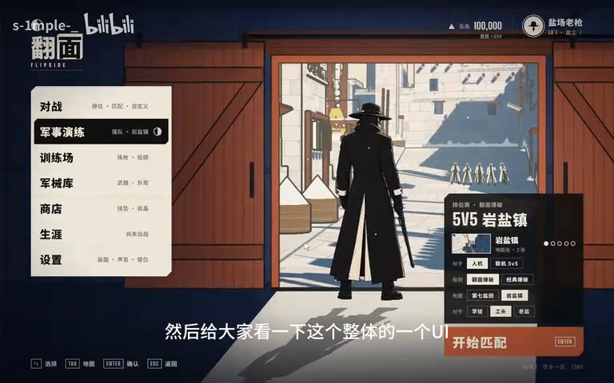
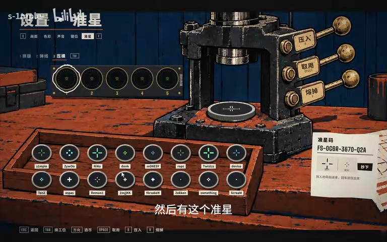

# 形体、线条、光线与空间的共同设计

这里从源画面可见关系出发，提供可泛化的美术指导。具体线宽、光照模型与构图比例由当前输出尺寸和主题决定。

## 先看整体形状

门框形成强矩形，人物是纵向深色剪影，门外建筑和地面有大片受光面，阴影形成斜向路径。人物衣摆与帽檐的曲线嵌在建筑的直线中。左侧阅读纸面、中央场景、右侧动作区具有不同尺度和明暗分量。

缩小画面时，门、人物、明亮出口和地面投影仍能被辨认。细颗粒和小字退去后，主要图像依然成立。这是构图和造型应承担的工作。

制作时先建立主轮廓、大块明暗、主要重叠和阅读方向，再逐步增加结构线、材料与细节。可在草图中用少量灰阶检查主次，数量随画面复杂度调整。

## 棱角与圆滑由用途决定

| 结构角色 | 形体处理的出发点 | 相邻形体之间的关系 |
|---|---|---|
| 承重框架、盒体、阅读面 | 稳定的直边、平面、明确厚度 | 用尺寸和投影建立重量，与可动部件形成分工 |
| 转轴、转盘、卷轴、观察孔 | 圆或椭圆、可理解的中心与轴向 | 圆形由运动或观察方式支持，外侧框架可以方正 |
| 手柄、抓握点、触摸端点 | 圆滑轮廓、局部鼓起、接触空间 | 较小而清楚的曲面集中在需要操作的位置 |
| 纸、薄片、软带、织物 | 薄边、局部弯折、有限弹性 | 平整信息面与一处弯曲边缘共同表达柔韧性 |
| 切割、折叠、拼接、缺口 | 位置明确的尖角、倒角或切面 | 让切口交代结构、开合或识别，保留相邻平静边缘 |
| 地形、人体、自然物 | 大曲线、具有节奏的轮廓转折 | 宽阔曲面可配硬边色块，流畅轮廓与图形化明暗并存 |

“圆滑轮廓”和“柔软光照”是两个独立选择。球形把手可以有清楚的亮面与暗面，方盒可以在一条边上有轻微倒圆。分别设计轮廓曲率、平面转折、厚度、材质、阴影边界，形体才会丰富。

界面圆角应继承其承载对象和交互语义。整页的按钮、图框、数据单元、拨片和图例可以共享秩序，同时保持各自的几何用途。角度、透视和裁切对阅读造成的影响，需要在目标尺寸检查。

## 线条的职责和轻重

源画面中的轮廓、分缝、纸面规则线与磨损痕迹承担不同工作。复用时按以下层级判断。

| 线的职责 | 应传达的信息 | 控制方式 |
|---|---|---|
| 外轮廓、前后遮挡、深缝 | 主体边界、深度、接触 | 对焦点和近处结构给予较强对比，注意局部线条的收放 |
| 构造线、平面转折、接缝 | 零件如何相连，体积如何转向 | 比轮廓轻，随表面方向组织，避免各面布满同密度线条 |
| 标尺、坐标、引线、表格线 | 信息对应与精确关系 | 清晰而克制，遵守数据和排版的实际几何 |
| 网点、排线、磨损、笔触 | 材料和局部明暗 | 聚集在有意义的区域，形成疏密与方向，保持阅读面平静 |

可从“强轮廓、较轻结构线、更细信息线”开始试画，再按尺寸调整。近处接触缝常比外露的亮边更暗。某些受光边可以由明暗差自行成立，留出呼吸。这个选择是可用的绘画方法，源视频不足以证明每条边的底层生成规则。

排线应随表面或阴影方向变化。木纹跟随木材，弯曲面上的笔触可以提示转向。密度也承担深度和注意力，远景与非焦点区域通常更简洁。

## 光线既描述体积，也组织注意力

构图开始时先选一个主要光向，判断光从哪里进入、先落在哪里、投影落到哪一面。实际场景可以更复杂，简化作品从统一方向入手更容易保持一致。

- 受光面和背光面决定物体的大体积。原作多用简化色面，暖受光与冷影反复出现。
- 投影描述物体与另一表面的空间关系。方向、缩短、遮挡和边界变化应与场景一致。
- 接触阴影固定物体的落点。纸压住台面、框架落地、零件嵌合处可以有短而深的暗部。
- 高光提示材质。金属允许集中而窄的亮边，木与纸更多依靠宽阔的明暗面。磨损可以集中在经常接触或凸起的边上。
- 明亮区域和最深暗部可以一起框定焦点。信息面需要足够平静，重要文字的对比度单独检查。

源视频的不同场景存在不同光向。它支持“同一场景内光线协调”的原则，无法据此固定所有未来作品的光源位置。

画面的蓝色需要有明确角色。蓝色背景可提供环境，蓝色阴影则应跟随被遮蔽的面或投影形状。仅把背景涂深蓝，体积和照明关系仍需另外建立。

## 让平面信息与空间表现相互支持

原作同时使用透视场景和屏幕信息。主要阅读平面可以保持正对观众，主体的厚度、侧面、短投影和邻近物件提供空间。更复杂的场景允许通过窗、模型、器械或截面进入深处。

建立前后层次时明确谁遮挡谁，物体落在哪里，视线从哪里进入。选择透视、轴测或平面编辑关系，使相邻元素遵守同一套空间逻辑。

静态版也能保留这些关系。可通过裁切、重叠、厚薄、局部剖面与投影交代空间。投影和景深的强度应服务当前媒介的阅读距离。

## 丰富度来自对比和安排

源作常把细节丰富的主体放在较安静的环境中。大平面允许眼睛停留，边缘、关节和操作点聚集更细的变化。需要同时考虑以下关系。

- 大块与小部件之间的尺度差。
- 直边与曲线、厚重与薄片、开口与实心之间的形体差。
- 明亮阅读面与较暗环境、宽阔亮面与集中高光之间的明暗差。
- 稳定排版与局部物件姿态之间的节奏差。
- 密集构造与空场之间的细节差。

比例与摆放需要在完成画面上判断。增加铆钉、网点和切角只会增加细节，主轮廓、明暗块和焦点的完成度仍须独立解决。

## 制作与检查

先把主要内容画到足以判断的完成度。选择适合输出的绘画、图像生成、建模、向量或原生排版工具。具有复杂曲面和材质的主角通常需要专门的图像或几何制作，交互图与精确剖面则适合可控的图形实现。

检查缩略图、实际尺寸和关键局部。先修正轮廓与重心，再修正厚度、连接和光向，最后调整纹理和小标记。成品应同时拥有清楚的整体和经得起近看的局部。
